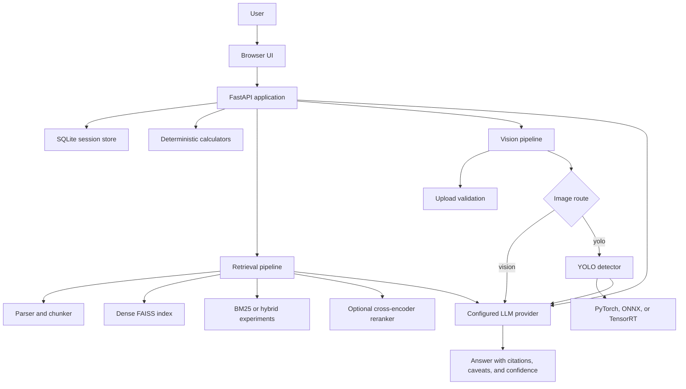

# VoltAgent

> A modular, source-grounded electrical-engineering assistant with deterministic calculations, local retrieval, optional YOLO circuit-component detection, and multimodal LLM explanations.

[](https://www.python.org/)
[](https://fastapi.tiangolo.com/)
[](tests/)
[](#license-and-model-licenses)

VoltAgent is designed as a practical engineering assistant rather than a single monolithic model wrapper. The application keeps deterministic work local, treats retrieved text and detector output as evidence, and delegates open-ended explanation to a configured conversational provider such as DeepSeek through an OpenAI-compatible API.

## Table of contents

- [What it does](#what-it-does)
- [Architecture](#architecture)
- [Repository layout](#repository-layout)
- [Quick start](#quick-start)
- [Configuration](#configuration)
- [Using the API](#using-the-api)
- [Retrieval and RAG](#retrieval-and-rag)
- [Vision and YOLO](#vision-and-yolo)
- [Evaluation](#evaluation)
- [Metrics glossary](#metrics-glossary)
- [Testing and quality checks](#testing-and-quality-checks)
- [Development workflow](#development-workflow)
- [Limitations and roadmap](#limitations-and-roadmap)
- [License and model licenses](#license-and-model-licenses)

## What it does

### Core capabilities

- Conversational electrical-engineering answers through OpenAI-compatible or Gemini providers.
- SQLite-backed conversation sessions and session titles.
- Deterministic calculators for common electrical quantities.
- Kuphaldt textbook parsing and stable section-aware chunking.
- Dense retrieval with Snowflake Arctic Embed L v2.
- Optional BM25, hybrid retrieval, and cross-encoder reranking experiments.
- Optional YOLO OBB circuit-component detection with PyTorch, ONNX, or TensorRT artifacts.
- Image upload validation and multimodal image chat.
- Agent-style image routing between native vision and detector-assisted analysis.
- Citation-aware responses when retrieved source context is available.
- A framework-free browser UI served by FastAPI.

### Design principles

1. **Deterministic work stays deterministic.** Electrical formulas, parsing, validation, and retrieval metrics are implemented as regular code.
2. **Evidence is not authority.** Retrieved chunks and detector output are explicitly treated as untrusted evidence.
3. **Optional dependencies fail safely.** The text assistant can run without YOLO, TensorRT, dense retrieval packages, or a local LLM.
4. **Evaluation claims stay scoped.** Detector localization metrics, retrieval metrics, and LLM inventory metrics are reported separately.
5. **Hardware-specific artifacts are built on the target machine.** TensorRT engines are not portable across arbitrary CUDA, GPU, or TensorRT versions.

## Architecture



### Text chat flow

```text
User message
  -> session persistence
  -> deterministic calculation detection
  -> dense retrieval when available
  -> legacy hash-vector fallback when needed
  -> optional reranking
  -> configured LLM
  -> answer plus source citations
```

### Image chat flow

```text
Image upload
  -> file validation and image_id
  -> LLM route decision: yolo or vision
  -> optional YOLO component detection
  -> original image plus detector evidence to the LLM
  -> user-facing explanation with confidence and caveats
```

The detector is not treated as a circuit solver. Bounding boxes do not establish electrical connectivity, component values, ratings, polarity, or circuit operation.

## Repository layout

```text
.
├── app/
│   ├── agent/                 Typed state, routing, prompts, and tool registry
│   ├── electrical/            Deterministic calculators and schemas
│   ├── providers/             OpenAI-compatible and Gemini adapters
│   ├── rag/                   Parsing, chunking, dense search, reranking, evaluation
│   ├── vision/                Upload validation, YOLO runtime selection, inference
│   ├── config.py              Environment-backed settings
│   ├── main.py                FastAPI composition root and HTTP routes
│   ├── schemas.py             Request and response models
│   └── session_store.py       SQLite conversation persistence
├── benchmarks/
│   ├── questions/             Curated retrieval questions
│   ├── results/               Reproducible benchmark JSON artifacts
│   └── scripts/               Retrieval, YOLO, and multimodal evaluation runners
├── data/
│   ├── documents/             Kuphaldt corpus and other local documents
│   └── evaluation/cghd/       CGHD image and Pascal VOC annotation subset
├── frontend/                  Framework-free HTML, CSS, and JavaScript UI
├── scripts/                   Model preparation, ingestion, inspection, and export tools
├── tests/                     Unit and API tests
├── .env.example               Configuration template
├── pyproject.toml             Dependencies and build configuration
└── README.md                  Project documentation
```

## Quick start

### Requirements

- Python 3.11 or newer
- [`uv`](https://docs.astral.sh/uv/)
- A configured conversational provider for live answers
- Optional CUDA, TensorRT, and vision dependencies for accelerated YOLO inference

### Install

```bash
uv sync --all-extras
cp .env.example .env
```

Edit `.env` with the provider and model you want to use. For DeepSeek:

```dotenv
LLM_PROVIDER=openai_compatible
LLM_MODEL=deepseek-flash
LLM_API_KEY=your-deepseek-key
LLM_BASE_URL=https://api.deepseek.com
```

Prepare optional local model artifacts:

```bash
uv run python -m scripts.prepare_local_models
```

Start the development server:

```bash
uv run uvicorn app.main:app --reload
```

Open <http://127.0.0.1:8000/> in a browser.

### Minimal text request

```bash
curl -s http://127.0.0.1:8000/api/chat \
  -H 'content-type: application/json' \
  -d '{"message":"Explain Ohm\u0027s law","session_id":null}'
```

Example response shape:

```json
{
  "session_id": "...",
  "session_title": "Ohm's Law",
  "answer": "...",
  "tool_calls": [],
  "sources": []
}
```

### Health check

```bash
curl -s http://127.0.0.1:8000/health
# {"status":"ok"}
```

## Configuration

The main settings are loaded from `.env` through `app.config.Settings`.

| Variable | Default | Purpose |
|---|---|---|
| `LLM_PROVIDER` | `openai_compatible` | `openai_compatible` or `gemini` |
| `LLM_MODEL` | empty | Conversational model name |
| `LLM_API_KEY` | empty | OpenAI-compatible provider key |
| `LLM_BASE_URL` | empty | OpenAI-compatible base URL |
| `GEMINI_API_KEY` | empty | Gemini provider key |
| `EMBEDDING_MODEL` | `Snowflake/snowflake-arctic-embed-l-v2.0` | Dense embedding model |
| `DENSE_INDEX_PATH` | `data/indexes/kuphaldt-arctic-embed-l-v2` | FAISS index directory |
| `RERANKER_ENABLED` | `false` | Enable local cross-encoder reranking |
| `RERANKER_MODEL` | `BAAI/bge-reranker-v2-m3` | Reranker model |
| `RERANKER_CANDIDATE_K` | `30` | Dense candidates sent to reranker |
| `RERANKER_BATCH_SIZE` | `16` | Reranker batch size |
| `RAG_TOP_K` | `5` | Final retrieved chunks |
| `YOLO_MODEL_PATH` | local `.pt` path | YOLO checkpoint or sibling artifact base |
| `YOLO_MODEL_RUNTIME` | `auto` | `auto`, `tensorrt`, `onnx`, or `pytorch` |
| `YOLO_DEVICE` | `auto` | Device override for detector inference |
| `VECTOR_DB_PATH` | `data/vectors.sqlite3` | Legacy hash-vector store |
| `DATABASE_URL` | `sqlite:///./data/voltagent.db` | Session database |
| `MAX_UPLOAD_BYTES` | 10 MiB | Upload size limit |

Secrets should remain in `.env` and must not be committed.

## Using the API

### Text chat

`POST /api/chat`

```json
{
  "message": "What is the current through a 1 kOhm resistor at 5 V?",
  "session_id": null,
  "image_id": null
}
```

`message` is required and limited to 20,000 characters. `session_id` continues an existing conversation. `image_id` attaches an uploaded image.

### Sessions

```text
GET    /api/sessions
GET    /api/sessions/{session_id}
DELETE /api/sessions/{session_id}
```

### Vision routes

```text
GET  /vision/health
POST /vision/upload
POST /vision/detect
```

Upload an image:

```bash
curl -s http://127.0.0.1:8000/vision/upload \
  -F 'file=@data/evaluation/cghd/subset/drafter_1/images/C10_D1_P1.jpg'
```

Then attach the returned `image_id` to chat:

```bash
curl -s http://127.0.0.1:8000/api/chat \
  -H 'content-type: application/json' \
  -d '{
    "message":"What is shown in this image?",
    "session_id":null,
    "image_id":"returned-image-id.jpg"
  }'
```

The response includes `tool_calls` for image routing and optional detector execution. Internal evidence is not a substitute for visual inspection or engineering verification.

## Retrieval and RAG

### Kuphaldt corpus

The parser in `app.rag.kuphaldt.KuphaldtParser` handles the supported numeric chapter pages from the local Kuphaldt volumes. It creates stable, section-aware `DocumentChunk` records and preserves source paths for citations.

Inspect the corpus:

```bash
uv run python -m scripts.inspect_kuphaldt
uv run python -m scripts.inspect_kuphaldt --volumes DC AC --chunk-size 512 --chunk-overlap 64
uv run python -m scripts.inspect_kuphaldt --volumes DC --json
```

Supported generic ingestion formats are `.md`, `.txt`, and `.pdf`:

```bash
uv run python scripts/ingest.py data/documents
```

### Dense index

Download or prepare the published Arctic index:

```bash
uv sync --extra dense
uv run python -m scripts.download_dense_index
```

The index contains 1,893 chunks and writes `chunks.faiss`, `chunks.json`, and `metadata.json` under `data/indexes/kuphaldt-arctic-embed-l-v2/`. To rebuild locally:

```bash
uv run python -m scripts.build_dense_index --device auto
```

The chat route prefers dense retrieval when the index and dependencies are available. It falls back to the legacy deterministic hash-vector store when dense retrieval is unavailable.

### Optional reranking

The optional reranking path retrieves up to 30 dense candidates, scores them with a local cross-encoder, and sends the final top-k chunks to the LLM.

```bash
uv run python -m benchmarks.scripts.evaluate_dense_and_rerank \
  --device cuda \
  --questions benchmarks/questions/kuphaldt_questions_expanded.json \
  --reranker-model BAAI/bge-reranker-v2-m3
```

Reranking is disabled by default because the benchmark did not show a consistent improvement over the strongest dense baseline.

## Vision and YOLO

Install optional vision dependencies:

```bash
uv sync --extra vision
```

The default model is `boscochanam/circuit-component-detector` with the `yolo26m_obb_16class_aug.pt` checkpoint. Export on the target machine:

```bash
uv run python -m scripts.export_yolo --format auto
```

Runtime selection:

1. TensorRT when CUDA and TensorRT are available.
2. ONNX when an exported ONNX artifact is available.
3. PyTorch as the fallback.

The detector caches the loaded model process-wide and serializes inference per cache key. The first TensorRT request loads the 184 MiB engine and allocates GPU memory. Later requests reuse the loaded engine.

TensorRT engines are hardware, CUDA, and TensorRT-version specific. Build them on the deployment machine. YOLO output provides coarse component localization. It does not prove values, ratings, polarity, connectivity, or circuit behavior.

## Evaluation

All benchmark outputs are committed as JSON artifacts under `benchmarks/results/`. The commands and result files are intentionally separate from runtime application data.

### Evaluation datasets

| Evaluation | Input | Size | Ground truth |
|---|---|---:|---|
| Retrieval baseline | `benchmarks/questions/kuphaldt_questions.json` | 36 questions | Relevant source sections |
| Retrieval expansion | `benchmarks/questions/kuphaldt_questions_expanded.json` | 161 questions | Relevant source sections plus metadata |
| YOLO backend comparison | One representative Kuphaldt image | 30 timed iterations per backend | Runtime and throughput |
| CGHD YOLO accuracy | `data/evaluation/cghd/subset` | 50 images | Pascal VOC XML boxes |
| Vision mode comparison | Same 50-image CGHD subset | 50 images per mode | Mapped component inventories |

### Metrics glossary

#### Retrieval metrics

- **Recall@k:** fraction of queries with at least one relevant source section in the top k results.
- **MRR@k:** mean reciprocal rank of the first relevant result, capped at k.
- **Dense:** embedding similarity retrieval before reranking.
- **Reranked:** dense candidates reordered by the cross-encoder.
- **Hybrid:** the repository's BM25 plus dense candidate combination before optional reranking.

#### Detection metrics

- **IoU:** intersection over union between predicted and ground-truth boxes.
- **AP50:** average precision at IoU threshold 0.50.
- **mAP50:** mean AP50 across mapped component classes.
- **Precision:** matched predictions divided by all predictions at the selected confidence and IoU thresholds.
- **Recall:** matched predictions divided by all ground-truth instances.
- **F1:** harmonic mean of precision and recall.
- **Latency:** end-to-end inference call time after warmup.
- **Throughput:** one divided by mean latency, expressed as frames per second.

#### Vision inventory metrics

For DeepSeek-only and YOLO-plus-DeepSeek, the benchmark asks the model for visible component classes and counts. It does not ask the model to produce ground-truth-aligned bounding boxes.

- **Inventory TP:** counted component instances matching the mapped ground-truth class.
- **Inventory FP:** predicted component counts beyond the ground-truth count.
- **Inventory FN:** ground-truth component counts not predicted.
- **Inventory micro precision/recall/F1:** count-based metrics across the complete 50-image subset.
- **Exact inventory match:** every class count must match for an image.
- **Mean absolute count error:** sum of absolute per-class count errors divided by images.

**Important:** inventory F1 is not mAP and must not be interpreted as localization accuracy.

### Retrieval benchmark: 161-question dense and reranked results

| Model | Dense R@5 | Dense R@10 | Dense MRR@10 | Reranked R@5 | Reranked R@10 | Reranked MRR@10 | Time (s) |
|---|---:|---:|---:|---:|---:|---:|---:|
| Snowflake Arctic L v2 | 0.8634 | 0.9441 | 0.7426 | 0.8385 | 0.9006 | 0.7084 | 66.65 |
| BGE base EN | 0.8323 | 0.9068 | 0.6758 | 0.8323 | 0.9130 | 0.7072 | 60.69 |
| BGE large EN | 0.8261 | 0.9068 | 0.6705 | 0.8323 | 0.9006 | 0.6924 | 61.68 |
| BGE m3 | 0.8447 | 0.8882 | 0.7025 | 0.8261 | 0.9006 | 0.6899 | 72.54 |
| BGE small EN | 0.8509 | 0.9193 | 0.6554 | 0.8199 | 0.9006 | 0.6916 | 59.41 |
| E5 base v2 | 0.8012 | 0.9068 | 0.6329 | 0.8261 | 0.8882 | 0.7084 | 56.79 |
| Electrical EmbeddingGemma IR | 0.9193 | 0.9503 | 0.7378 | 0.8447 | 0.9006 | 0.6945 | 62.76 |
| Jina v5 nano retrieval | 0.8696 | 0.9130 | 0.7010 | 0.8571 | 0.9255 | 0.7070 | 59.24 |
| Qwen3 Embedding 0.6B | 0.8820 | 0.9503 | 0.7168 | 0.8447 | 0.9130 | 0.6987 | 62.71 |
| SPECTER2 base | 0.2298 | 0.3106 | 0.1593 | 0.3602 | 0.4037 | 0.2966 | 20.64 |

The strongest dense Recall@10 result was 0.9503, shared by Electrical EmbeddingGemma IR and Qwen3. The strongest reranked Recall@10 result was 0.9255 from Jina v5 nano retrieval. Reranking is therefore retained as an experiment, not enabled as an unconditional quality improvement.

### Retrieval baseline: 36-question lexical evaluation

The deterministic local baseline evaluates 36 manually reviewed queries against 1,893 chunks and 889 parsed sections:

| Metric | Value |
|---|---:|
| Queries | 36 |
| Chunks | 1,893 |
| Sections | 889 |
| Recall@5 | 0.5000 |
| Recall@10 | 0.6667 |
| MRR@10 | 0.3626 |
| Parsing errors | 0 |
| Index build time | 2.886 s |
| Evaluation time | 1.478 s |
| Total time | 4.364 s |

This is a deterministic baseline for regression checks. It is not evidence that lexical retrieval is better than dense, hybrid, or reranked retrieval.

### Hybrid retrieval ablation

The hybrid experiment used BM25 plus dense retrieval with `alpha=0.7`, 100 dense candidates, and 30 reranker candidates.

| Model | Dense R@10 | Dense MRR@10 | Hybrid R@10 | Hybrid MRR@10 |
|---|---:|---:|---:|---:|
| Snowflake Arctic L v2 | 0.9441 | 0.7426 | 0.9255 | 0.7431 |
| BGE base EN | 0.9068 | 0.6758 | 0.9317 | 0.7050 |
| BGE large EN | 0.9068 | 0.6705 | 0.9006 | 0.7092 |
| BGE m3 | 0.8882 | 0.7025 | 0.8882 | 0.7194 |
| BGE small EN | 0.9193 | 0.6554 | 0.9068 | 0.7088 |
| E5 base v2 | 0.9068 | 0.6329 | 0.8944 | 0.6689 |
| Electrical EmbeddingGemma IR | 0.9503 | 0.7378 | 0.9317 | 0.7334 |
| Jina v5 nano retrieval | 0.9130 | 0.7010 | 0.9503 | 0.7222 |
| Qwen3 Embedding 0.6B | 0.9503 | 0.7168 | 0.9317 | 0.7406 |
| SPECTER2 base | 0.3106 | 0.1593 | 0.4472 | 0.2421 |

Alternative reranker results for the three tested dense models are recorded in `benchmarks/results/hybrid_reranker_ablation.json`. The experiment notes that Jina reranker loading was skipped because its repository requires `trust_remote_code=True`.

### YOLO backend performance

This benchmark used 8 warmup iterations and 30 timed iterations on an NVIDIA CMP 40HX with CUDA available.

| Backend | Device | Mean latency | Median | P95 | Throughput | Notes |
|---|---|---:|---:|---:|---:|---|
| PyTorch | CUDA:0 | 16.470 ms | 16.013 ms | 18.085 ms | 60.715 FPS | Baseline |
| ONNX | CUDA execution provider | 19.571 ms | 19.541 ms | 19.881 ms | 51.097 FPS | Provider plugin warning, not a clean all-GPU comparison |
| TensorRT FP16 | CUDA:0 | **7.122 ms** | **7.089 ms** | **7.535 ms** | **140.408 FPS** | Fastest measured backend |

TensorRT was 2.31x faster than PyTorch and reduced mean latency by 56.8 percent in this benchmark.

### CGHD YOLO accuracy on 50 images

The evaluator uses Pascal VOC XML annotations, maps 61 CGHD labels into the detector's 16 classes, and compares axis-aligned ground-truth boxes with YOLO OBB `xyxy` boxes at IoU 0.50.

| Backend | Detections | Mean detections/image | mAP50 | Precision | Recall | F1 | Elapsed |
|---|---:|---:|---:|---:|---:|---:|---:|
| PyTorch | 5,478 | 109.56 | 0.6000 | 0.8268 | 0.7848 | 0.8053 | 7.637 s |
| ONNX | 4,450 | 89.00 | 0.5880 | 0.8262 | 0.7941 | 0.8098 | 4.957 s |
| TensorRT | 4,453 | 89.06 | 0.5877 | 0.8262 | 0.7941 | 0.8098 | 3.878 s |

Per-class AP50:

| Class | PyTorch | ONNX | TensorRT |
|---|---:|---:|---:|
| resistor | 0.1882 | 0.1891 | 0.1893 |
| terminal | 0.9802 | 0.9802 | 0.9802 |
| crossover | 1.0000 | 1.0000 | 1.0000 |
| capacitor | 0.0000 | 0.0000 | 0.0000 |
| diode | 0.9543 | 0.9095 | 0.9097 |
| transistor | 0.0000 | 0.0000 | 0.0000 |
| switch | 1.0000 | 1.0000 | 1.0000 |
| inductor | 0.0000 | 0.0000 | 0.0000 |
| voltage_source | 0.0000 | 0.0000 | 0.0000 |
| text | 0.9558 | 0.9630 | 0.9630 |
| junction | 0.9348 | 0.9548 | 0.9547 |
| gnd | 0.9959 | 0.9963 | 0.9973 |
| integrated_circuit | 1.0000 | 1.0000 | 1.0000 |
| other | 0.3907 | 0.2394 | 0.2335 |

Backend agreement at class-aware IoU 0.50 was 100 percent between ONNX and TensorRT for the measured detections. PyTorch matched 99.30 percent of its detections against ONNX/TensorRT under the reported agreement calculation.

### Three-way vision mode comparison

This benchmark uses the same 50 CGHD images and asks each mode for a visible component inventory. DeepSeek-only and YOLO-plus-DeepSeek are not bbox evaluations.

| Mode | Inventory precision | Inventory recall | Inventory F1 | Exact inventory match | Mean absolute count error | JSON parse success |
|---|---:|---:|---:|---:|---:|---:|
| YOLO-only | 0.9141 | 0.8785 | **0.8960** | 0.0000 | 6.18 | N/A |
| YOLO + DeepSeek | 0.8993 | 0.7663 | 0.8275 | 0.0000 | 9.68 | 1.0000 |
| DeepSeek-only | 0.8493 | 0.4871 | 0.6191 | 0.0000 | 18.16 | 1.0000 |

Interpretation:

- YOLO-only is strongest for the common count-based inventory metric.
- YOLO plus DeepSeek improves inventory F1 over DeepSeek-only by 0.2084.
- The hybrid mode reduces false negatives from 777 to 354 compared with DeepSeek-only.
- Exact inventory match is zero for all modes because the diagrams are dense and the criterion requires every class count to match exactly.
- These inventory scores must not be compared directly with YOLO mAP. The authoritative artifacts are:
  - `benchmarks/results/cghd_vision_modes_comparison_2026-10-21.json`
  - `benchmarks/results/cghd_deepseek_only_2026-10-21.json`
  - `benchmarks/results/cghd_yolo_plus_deepseek_2026-10-21.json`
  - `benchmarks/results/yolo_accuracy_subset_2026-10-21.json`

## Testing and quality checks

Run the standard suite:

```bash
uv run pytest -q
uv run ruff check app scripts tests
```

Current validation snapshot:

```text
28 passed
Ruff: all checks passed
JSON result artifacts: valid
Changed modules: compile successfully
Source distribution: built successfully
Wheel: built successfully
```

The tests cover:

| Area | Coverage |
|---|---|
| API | Health endpoint and public request/response boundaries |
| Agent scaffolding | Typed state, registry, router, and decision interfaces |
| Electrical calculations | Deterministic formulas and validation |
| Retrieval evaluation | Recall@5, Recall@10, MRR@10, unmatched source rejection |
| Kuphaldt parser | Section parsing, chunking, source metadata, skipped content |
| Dense retrieval | Index loading, query behavior, fallback paths |
| Reranking | Candidate scoring, configuration, and failure handling |
| Prompts | Global assistant behavior, citations, image routing, detector evidence policy |
| Vision routing | Route parsing and safe fallback behavior |
| Uploads | Image validation and size/type failures |

The normal test suite uses mocks and synthetic fixtures. It does not require cloud credentials, a YOLO checkpoint, or live LLM inference.

## Development workflow

Install all development and optional dependencies:

```bash
uv sync --all-extras
```

Run focused checks:

```bash
uv run pytest tests/test_api.py tests/test_vision_routing.py -q
uv run pytest tests/test_evaluation.py tests/test_rag.py -q
uv run ruff check app scripts tests
uv run python -m py_compile app/providers/base.py benchmarks/scripts/evaluate_vision_modes.py
```

Build packages:

```bash
uv build
```

Run the retrieval benchmark:

```bash
uv run python -m benchmarks.scripts.evaluate_retrieval --json
```

Run the YOLO backend benchmark:

```bash
uv run python -m benchmarks.scripts.evaluate_yolo_backends \
  --subset data/evaluation/cghd/subset \
  --output benchmarks/results/yolo_accuracy_subset_2026-10-21.json
```

Run the three-mode vision evaluation:

```bash
uv run python -m benchmarks.scripts.evaluate_vision_modes \
  --limit 50 \
  --output benchmarks/results/cghd_vision_modes_comparison_2026-10-21.json
```

DeepSeek vision calls are intentionally bounded by a client timeout and the evaluator supports resumable checkpoints:

```bash
uv run python -m benchmarks.scripts.evaluate_vision_modes \
  --limit 50 \
  --modes deepseek_only \
  --resume \
  --max-new 10 \
  --output benchmarks/results/cghd_deepseek_only_2026-10-21.json
```

## Limitations and roadmap

### Current limitations

- The CGHD vision benchmark uses a 50-image subset, not the full validation split.
- CGHD labels are merged from 61 source labels into the detector's 16 evaluation classes.
- Ground-truth Pascal VOC boxes are axis-aligned while YOLO predictions are OBB-derived `xyxy` boxes.
- DeepSeek-only and hybrid inventory metrics do not evaluate localization.
- Dense retrieval and reranking results come from separate benchmark environments and should be reproduced on the target machine before production decisions.
- The application does not infer circuit connectivity from pixels.
- Model outputs are not a substitute for engineering review or electrical safety procedures.
- TensorRT performance depends on the exact GPU, CUDA, driver, TensorRT version, and engine build.
- The conversational provider is required for live LLM answers.

### Roadmap

- Add a true structured multimodal benchmark with a defined semantic rubric for final answers.
- Add a fair localization benchmark for any vision model that can emit image coordinates.
- Render detection overlays and confidence summaries in the frontend.
- Add graph-based circuit topology extraction with explicit uncertainty handling.
- Add stronger end-to-end citation and answer-faithfulness evaluation.
- Add CI jobs for tests, lint, packaging, and small deterministic benchmark fixtures.

## License and model licenses

This repository's application code and included data may have different licensing terms. Review each upstream license before redistribution.

In particular, the configured circuit-component model repository is external to this application. Review its license, including AGPL obligations where applicable, before shipping a production deployment or distributing a container that includes its weights.

Do not commit API keys, private datasets, model credentials, or generated local secrets.

## Acknowledgments

VoltAgent builds on the Kuphaldt *Lessons in Electric Circuits* corpus, Hugging Face model ecosystems, Ultralytics inference tooling, FAISS, FastAPI, and the broader Python open-source community.
